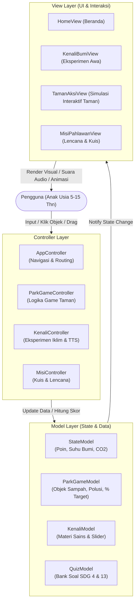

# RANCANGAN ARSITEKTUR & DESAIN SISTEM BUMIKITA
## Inovasi Teknologi Edukasi Iklim Berbasis Gamifikasi Interaktif (SDG 4 & SDG 13)

---

### I. LATAR BELAKANG & TUJUAN ESAY

* **Tema Besar:**  
  *Pendidikan Berkualitas di Era Perubahan Iklim: Strategi dan Inovasi Teknologi untuk Generasi Berkelanjutan dalam mendukung SDGs 4&13*
* **Sub-Tema:**  
  *SDGs Poin 4 & 13 (Pendidikan Berkualitas dan Perubahan Iklim)*
* **Target Pengguna:**  
  Anak-anak dan remaja rentang usia **5 – 15 tahun** (Taman Kanak-Kanak, Sekolah Dasar hingga Menengah Pertama).
* **Urgensi & Filosofi Pedagogis:**  
  Anak usia dini hingga remaja membutuhkan media edukasi yang tidak sekadar menyajikan teks teoretis tentang pemanasan global. Mereka membutuhkan media belajar berbasis **pembelajaran pengalaman langsung (*experiential learning*)** dan **penanaman kebiasaan nyata (*actionable habit nudging*)**. Dengan simulasi interaktif yang menyenangkan, anak memahami hubungan sebab-akibat (*cause-and-effect*): tindakan kecil mereka (memilah sampah, hemat listrik, memilih transportasi bersih) berdampak langsung pada kelestarian bumi.

---

### II. REKONSREUKSI ARSITEKTUR: POLA MVC (MODEL-VIEW-CONTROLLER)

Untuk menjaga kode tetap bersih, teruji, modular, dan mudah dikembangkan untuk kebutuhan demonstrasi esai serta pengembangan skala luas, sistem dirancang menggunakan pola **Modular Client-Side MVC**:



#### 1. Pembagian Tanggung Jawab (Separation of Concerns)
* **Model (`src/models/`):**
  * `StateModel.js`: Menyimpan state global pemain (Poin Hijau 🌿, Penurunan Suhu Mikro Bumi °C, Akumulasi kg CO₂ dicegah, Lencana yang terbuka, Level pahlawan).
  * `ParkGameModel.js`: Mengelola data objek pada simulasi taman (posisi sampah, status kendaraan bermotor berpolusi, status penanaman pohon, persentase kebersihan yang dihitung secara dinamis dari target).
  * `KenaliModel.js`: Data materi sains atmosfer dan ketebalan selimut gas rumah kaca.
  * `QuizModel.js`: Bank soal seputar aksi iklim dan keberlanjutan.
* **View (`src/views/`):**
  * Hanya bertugas merender tampilan DOM, mendengarkan event pengguna (klik, sentuhan), dan memperbarui visual saat data berubah.
  * Menampilkan maskot (`Terra`, `Awa`, `Nala`, `Pila`, `Tata`) sesuai konteksnya.
  * Mengatur canvas / layer transisi antara `Taman Kotor.png` dan `Taman Bersih.png`.
* **Controller (`src/controllers/`):**
  * Menerima input dari View, memvalidasi logika bisnis, memperbarui Model, lalu meminta View melakukan pembaruan tampilan (*re-render* / manipulasi CSS).
  * Memanggil utilitas suara sintetis (*Web Audio API*) dan *Speech Synthesis* (narasi suara bahasa Indonesia).

---

### III. STRUKTUR FOLDER PROYEK YANG DIROMBAK

```text
FIPP/
│
├── public/                           # Berkas statis dan media
│   └── images/                       # Aset ilustrasi karakter & lingkungan
│       ├── Terra.png                 # Maskot Bumi (Beranda & Indikator Suhu)
│       ├── Awa.png                   # Maskot Awan/Atmosfer (Kenali Bumi)
│       ├── Nala.png                  # Maskot Bohlam Lampu (Hemat Energi)
│       ├── Pila.png                  # Maskot Tong Sampah 3 Wadah (Pilah Sampah)
│       ├── Tata.png                  # Maskot Pohon Arsitek (Penataan Kota Hijau)
│       ├── Taman Bersih.png          # Ilustrasi Taman Kondisi Asri & Sehat
│       └── Taman Kotor.png           # Ilustrasi Taman Kondisi Rusak & Tercemar
│
├── src/                              # Sumber kode modular MVC
│   ├── models/
│   │   ├── StateModel.js
│   │   ├── ParkGameModel.js
│   │   ├── KenaliModel.js
│   │   └── QuizModel.js
│   │
│   ├── views/
│   │   ├── HomeView.js
│   │   ├── KenaliBumiView.js
│   │   ├── TamanAksiView.js          # HALAMAN BARU GABUNGAN (Game Simulasi Taman)
│   │   ├── MisiPahlawanView.js
│   │   └── components/
│   │       ├── MascotDialogue.js     # Balon dialog maskot ekspresif
│   │       ├── AudioPlayer.js        # Efek suara ramah anak (pop, celengan, terompet)
│   │       └── ConfettiFx.js         # Efek partikel kemenangan
│   │
│   ├── controllers/
│   │   ├── AppController.js
│   │   ├── KenaliController.js
│   │   ├── ParkGameController.js
│   │   └── QuizController.js
│   │
│   └── utils/
│       ├── AudioSynth.js             # Generator nada murni Web Audio API
│       └── SpeechHelper.js           # Text-to-Speech bahasa Indonesia
│
├── index.html                        # Berkas utama Single-Page Application (SPA)
├── Mockup-Design.html                # Mockup acuan awal (arsip referensi)
└── DESIGN.md                         # Dokumen arsitektur & rancangan ini
```

---

### IV. SPESIFIKASI HALAMAN GABUNGAN: "TAMAN AKSI HIJAU"
*(Menggabungkan Fitur "Pilih Aksimu!" dan "Bangun Kota Hijau")*

#### 1. Usulan Nama Halaman:
* **Pilihan 1 (Utama):** **"Taman Aksi Hijau"** *(Green City Action Park)*  
* Pilihan 2: **"Misi Taman Asri"**
* Pilihan 3: **"Simulasi Kota Impian Terra"**

#### 2. Konsep Visual & Mekanisme Permainan (*Interactive Gameplay Loop*):
Halaman ini dirancang layaknya panggung permainan simulasi interaktif (*interactive diorama mini-game*):

1. **Kondisi Awal (Tantangan):**
   * Latar belakang menampilkan kawasan yang terdegradasi berdasarkan aset `Taman Kotor.png`: rumput menguning, kolam mengering keruh, aspal berlubang dengan noda oli knalpot, serta sampah bertebaran.
   * Di sudut layar terdapat **Target Meter Kebersihan & Keasrian**: Dimulai dari **0% (Tercemar)** menuju target **100% (Taman Asri Sempurna)**.

2. **Objek Interaktif & Pahlawan Aksi:**
   * **Misi 1: Berburu Sampah (Bersama Maskot `Pila`):**
     * Di atas peta terdapat 5–8 titik sampah (botol plastik sekali pakai, kaleng minuman, kantong kresek).
     * Saat anak mengklik salah satu sampah, muncul animasi sampah melayang masuk ke wadah pilah pada sabuk maskot **Pila**.
     * Suara *"Plop/Tring!"* berbunyi, poin bertambah (+15 Poin 🌿), dan meteran kebersihan bertambah (+25%).
   * **Misi 2: Hentikan Asap Kendaraan (Bersama Maskot `Nala`):**
     * Di jalan raya bawah, tampak sepeda motor/mobil mengeluarkan asap knalpot hitam pekat.
     * Ketika anak menyentuh kendaraan tersebut, muncul dialog pilihan dilema kilat:  
       *"Asap kendaraan membuat Awa terbatuk-batuk! Apa solusinya?"*  
       *Pilihan A:* Ganti dengan Sepeda Santai & Jalur Sepeda Hijau! (Aksi Tepat)  
       *Pilihan B:* Biarkan motor gas pol. (Salah)
     * Ketika Pilihan A diambil, asap menghilang, marka sepeda hijau menyala terang, dan anak pesepeda muncul melintas! Meteran naik (+25%).
   * **Misi 3: Hijaukan Lahan & Air Bersih (Bersama Maskot `Tata`):**
     * Anak menyentuh area tanah tandus dan kolam keruh.
     * Maskot pohon arsitek **Tata** bertopi kuning hadir menanam pohon peneduh rindang dan membersihkan kolam.
     * Air kolam seketika berubah menjadi biru berkilau (*sparkling blue pond*). Meteran naik (+25%).
   * **Misi 4: Energi Terbarukan Kota:**
     * Anak dapat memasang lampu jalan bertenaga surya (*solar panel*) di samping bangku taman. Meteran naik hingga genap **100%**.

3. **Efek Transisi Visual (*Dynamic Revealing*):**
   * Seiring persentase kebersihan naik (0% ➔ 25% ➔ 50% ➔ 75% ➔ 100%), elemen visual dari `Taman Kotor.png` perlahan bertransformasi (menggunakan teknik *CSS opacity blend / clip-path reveal*) memperlihatkan keindahan dari `Taman Bersih.png`.
   * Anak secara visual melihat langsung buah dari pilihan aksi nyata mereka!

4. **Kondisi Kemenangan (*Victory Condition*):**
   * Begitu mencapai **100% Asri**:
     * Hujan konfeti warna-warni (*canvas-confetti*).
     * Nada selebrasi ceria (*celebration jingle*).
     * Suara narasi Terra: *"Hore! Kamu berhasil mengembalikan senyum taman kota! Suhu mikro turun 0.5°C dan 1.2 kg CO₂ berhasil dicegah!"*
     * Hadiah Lencana Emas: **"Arsitek Taman Asri Nusantara"** langsung tersemat di lemari piala.

---

### V. PEMETAAN ASET DAN PERAN EDUKASI MASKOT

| Aset Gambar | Nama Karakter | Modul Terkait | Peran Edukasi bagi Anak |
| :--- | :--- | :--- | :--- |
| `Terra.png` | **Terra** (Si Bumi Cilik) | Beranda & Header Global | Menjadi narator utama, mengabarkan status kesehatan bumi dan suhu global. |
| `Awa.png` | **Awa** (Si Awan Lembut) | 1. Kenali Bumi | Menjelaskan konsep atmosfer dan analogi *"Bumi Pakai Selimut"* (efek gas rumah kaca). |
| `Nala.png` | **Nala** (Si Bohlam Ceria) | 2. Taman Aksi Hijau | Mengajarkan penghematan listrik, pencabutan kabel saat tidak dipakai, dan transportasi ramah lingkungan. |
| `Pila.png` | **Pila** (Si Tong Pilah Sampah) | 2. Taman Aksi Hijau | Mengajak anak memilah sampah organik, anorganik plastik, dan kertas serta menghindari wadah sekali pakai. |
| `Tata.png` | **Tata** (Si Pohon Arsitek) | 2. Taman Aksi Hijau | Mengedukasi pentingnya ruang terbuka hijau (RTH) dan pepohonan sebagai penyerap karbon alami kota. |
| `Taman Kotor.png` | Kondisi Krisis | Background Game (0%) | Menunjukkan dampak nyata dari kelalaian manusia (pencemaran, kekeringan, polusi). |
| `Taman Bersih.png` | Kondisi Harapan | Background Game (100%) | Memberikan kepuasan visual (*visual reward*) atas keberhasilan aksi iklim generasi muda. |

---

### VI. KETERKAITAN DENGAN ESAY ILMIAH (SDG 4 & SDG 13)

1. **SDG 4 — Pendidikan Berkualitas (*Quality Education*):**
   * *Inklusif & Ramah Usia Dini:* Antarmuka minim teks rumit, dilengkapi fitur suara naratif (*Text-to-Speech*) yang membantu anak usia 5–7 tahun yang baru belajar membaca.
   * *Active Learning:* Mengubah pola pengajaran pasif (membaca buku pelajaran) menjadi interaksi gamifikasi mandiri.
2. **SDG 13 — Penanganan Perubahan Iklim (*Climate Action*):**
   * *Sense of Urgency & Self-Efficacy:* Anak tidak dibuat cemas oleh isu krisis iklim (*eco-anxiety*), melainkan diberdayakan bahwa keputusan mereka sehari-hari dapat mendinginkan bumi (*empowerment*).
   * Menghubungkan indikator mikrokosmos (taman kota) dengan indikator makrokosmos global (suhu bumi dunia dan emisi CO₂).

---

### VII. RENCANA TAHAPAN EKSEKUSI (ROADMAP)

1. **Fase 1: Penataan Berkas & Aset** *(Telah Selesai)*
   * Memindahkan seluruh gambar ilustrasi ke dalam direktori `public/images/`.
   * Mendokumentasikan spesifikasi arsitektur dalam `DESIGN.md`.
2. **Fase 2: Pembuatan Kerangka MVC Modular**
   * Membuat file model (`StateModel.js`, `ParkGameModel.js`).
   * Membuat controller penggerak game dan navigasi.
   * Membuat view modular berbasis ES6 module atau SPA terstruktur.
3. **Fase 3: Implementasi Penuh Halaman "Taman Aksi Hijau"**
   * Mengintegrasikan `Taman Kotor.png` dan `Taman Bersih.png` dengan sistem transisi interaktif.
   * Menempatkan hotspot sampah interaktif, kendaraan berpolusi, dan penanaman pohon.
   * Mengaktifkan perhitungan target persentase kebersihan (0% - 100%).
4. **Fase 4: Integrasi Maskot & Polish Interaksi**
   * Menggantikan gambar placeholder/SVG dengan aset karakter asli (`Terra`, `Awa`, `Nala`, `Pila`, `Tata`).
   * Menguji keselarasan efek audio Web Audio API dan TTS bahasa Indonesia.
